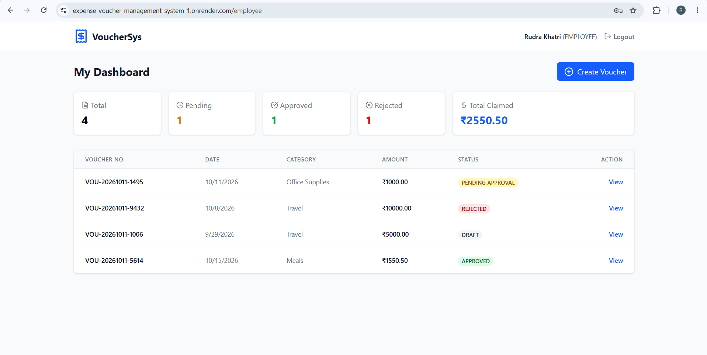
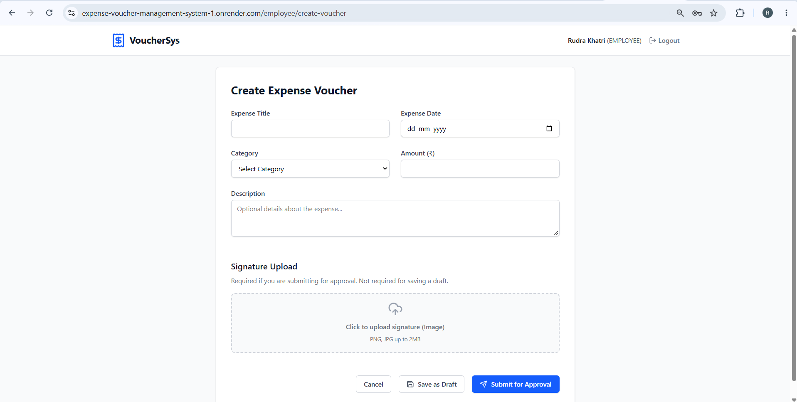
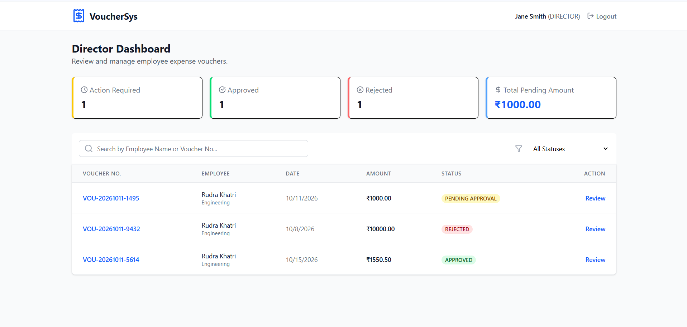
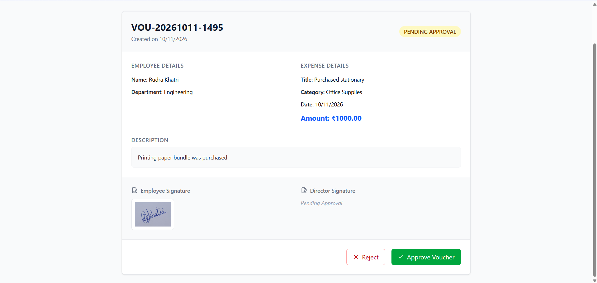
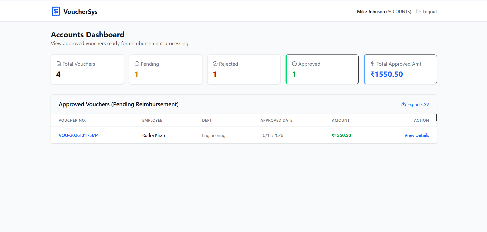

# Expense Voucher Management System

**🟢 Live Demo:** [https://expense-voucher-management-system-1.onrender.com](https://expense-voucher-management-system-1.onrender.com)

A full-stack web application designed to digitize and manage the lifecycle of employee expense reimbursements. The system enforces strict role-based access control (RBAC), signature validations, and sequential state transitions (Draft → Pending Approval → Approved / Rejected).

## 🔑 Test Credentials
You can use the following accounts to immediately test the role-based dashboards without registering:

**Employee Account:**
* **Email:** rudrakhatri930@gmail.com
* **Password:** rudra123

**Director Account:**
* **Email:** jane.director@example.com
* **Password:** password123

**Accounts Team:**
* **Email:** mike.accounts@example.com
* **Password:** password123

---

## 📸 Screenshots

Here is a look at the core workflows, role-based access control (RBAC), and dynamic aggregations in action.

**1. Employee Dashboard**  
*Demonstrates data isolation (employees only see their own vouchers) and individual metric aggregations.*  

**2. Create Voucher & Signature Upload**  
*Demonstrates form validation and the Cloudinary integration for uploading the mandatory employee signature.*  

**3. Director Dashboard (Search & Filter)**  
*Demonstrates the dynamic backend querying, allowing the Director to filter by status or search for specific employees and voucher numbers.*  

**4. Director Approval Workflow**  
*Demonstrates the state management and RBAC rules where a Director can view the employee's uploaded signature, provide a rejection reason, or upload their own signature to approve.*  

**5. Accounts Dashboard**  
*Demonstrates the read-only requirement for the Accounts team and showcases the MongoDB `$sum` aggregation pipelines calculating the total approved payout amounts.*  

---

## 🚀 Tech Stack

*   **Frontend:** React.js (Vite), Tailwind CSS, React Router, React Hook Form, Axios
*   **Backend:** Node.js, Express.js
*   **Database:** MongoDB Atlas (Mongoose ORM)
*   **Storage:** Cloudinary (for secure signature image hosting)
*   **Authentication:** JSON Web Tokens (JWT) & bcrypt

---

## 🧠 Key Assumptions & Business Logic Applied

1.  **Draft Editability:** Vouchers can only be edited by the original Employee and only while in the `DRAFT` state.
2.  **Mandatory Signatures:** An Employee cannot submit a voucher without uploading a signature. A Director cannot approve a voucher without uploading their signature. 
3.  **Rejection Rules:** A Director must provide a textual rejection reason if denying a voucher.
4.  **Voucher Numbering:** Voucher numbers are auto-generated sequentially on the backend (e.g., `VOU-YYYYMMDD-XXXX`).
5.  **Data Isolation:** Employees can only view their own vouchers. Directors can view all non-draft vouchers. The Accounts team can *only* view Approved vouchers (Read-Only).

---

## ⚙️ Local Setup Instructions

### Prerequisites
*   Node.js (v18+)
*   MongoDB Atlas Account (or local MongoDB)
*   Cloudinary Account (Free tier)

### 1. Clone the Repository
\`\`\`bash
git clone <your-github-repo-url>
cd expense-voucher-system
\`\`\`

### 2. Backend Setup
\`\`\`bash
cd backend
npm install
\`\`\`
Create a `.env` file in the `backend` directory (refer to `.env.example` below).
\`\`\`bash
npm run dev
\`\`\`
*The backend will run on http://localhost:5000*

### 3. Frontend Setup
Open a new terminal window:
\`\`\`bash
cd frontend
npm install
\`\`\`
Create a `.env` file in the `frontend` directory:
\`\`\`env
VITE_API_URL=http://localhost:5000/api
\`\`\`
\`\`\`bash
npm run dev
\`\`\`
*The frontend will run on http://localhost:5173*

---

## 🔐 Environment Variables (.env.example)

**Backend `.env`**
\`\`\`env
PORT=5000
NODE_ENV=development
MONGODB_URI=your_mongodb_atlas_connection_string
JWT_SECRET=your_super_secret_jwt_key
JWT_EXPIRE=30d
CLOUDINARY_CLOUD_NAME=your_cloudinary_cloud_name
CLOUDINARY_API_KEY=your_cloudinary_api_key
CLOUDINARY_API_SECRET=your_cloudinary_api_secret
\`\`\`

---

## 🗄️ Database Schema (MongoDB / Mongoose)

### 1. User Schema
*   `_id`: ObjectId
*   `employeeId`: String (Required if role is EMPLOYEE)
*   `name`: String
*   `email`: String (Unique)
*   `password`: String (Hashed via bcrypt)
*   `role`: String Enum (`EMPLOYEE`, `DIRECTOR`, `ACCOUNTS`)
*   `department`: String (Required if role is EMPLOYEE)

### 2. Voucher Schema
*   `_id`: ObjectId
*   `voucherNumber`: String (Unique, Auto-generated)
*   `createdBy`: ObjectId (Ref: User)
*   `employeeName`: String
*   `department`: String
*   `expenseDate`: Date
*   `expenseTitle`: String
*   `expenseCategory`: String
*   `expenseDescription`: String
*   `amount`: Number (Min: 0.01)
*   `status`: String Enum (`DRAFT`, `PENDING_APPROVAL`, `APPROVED`, `REJECTED`) - Default: `DRAFT`
*   `employeeSignatureUrl`: String (Cloudinary URL)
*   `directorSignatureUrl`: String (Cloudinary URL)
*   `rejectionReason`: String
*   `approvalDate`: Date
*   `timestamps`: Built-in Mongoose `createdAt` and `updatedAt`

---

## 📡 API Documentation

All endpoints are prefixed with `/api`. Protected routes require a `Bearer <token>` in the Authorization header.

### Authentication
*   `POST /auth/register` - Register a new user (Supports all 3 roles)
*   `POST /auth/login` - Authenticate user & receive JWT

### Vouchers
*   `GET /vouchers` - Get vouchers (Supports dynamic query filters: `?status=`, `?search=`, `?startDate=`, `?endDate=`, `?minAmount=`, `?maxAmount=`)
*   `GET /vouchers/:id` - Get a specific voucher by ID
*   `POST /vouchers` - Create a new `DRAFT` voucher *(Employee Only)*
*   `PUT /vouchers/:id` - Update a `DRAFT` voucher *(Employee Only)*
*   `PATCH /vouchers/:id/submit` - Submit draft for approval (Requires `employeeSignatureUrl`) *(Employee Only)*
*   `PATCH /vouchers/:id/approve` - Approve a voucher (Requires `directorSignatureUrl`) *(Director Only)*
*   `PATCH /vouchers/:id/reject` - Reject a voucher (Requires `rejectionReason`) *(Director Only)*

### Dashboards
*   `GET /dashboard/stats` - Returns aggregated metrics dynamically calculated based on the requester's role using MongoDB Aggregation Pipelines (`$group`, `$sum`, `$match`).

### File Uploads
*   `POST /upload/signature` - Uploads a multipart/form-data image to Cloudinary and returns the secure URL.